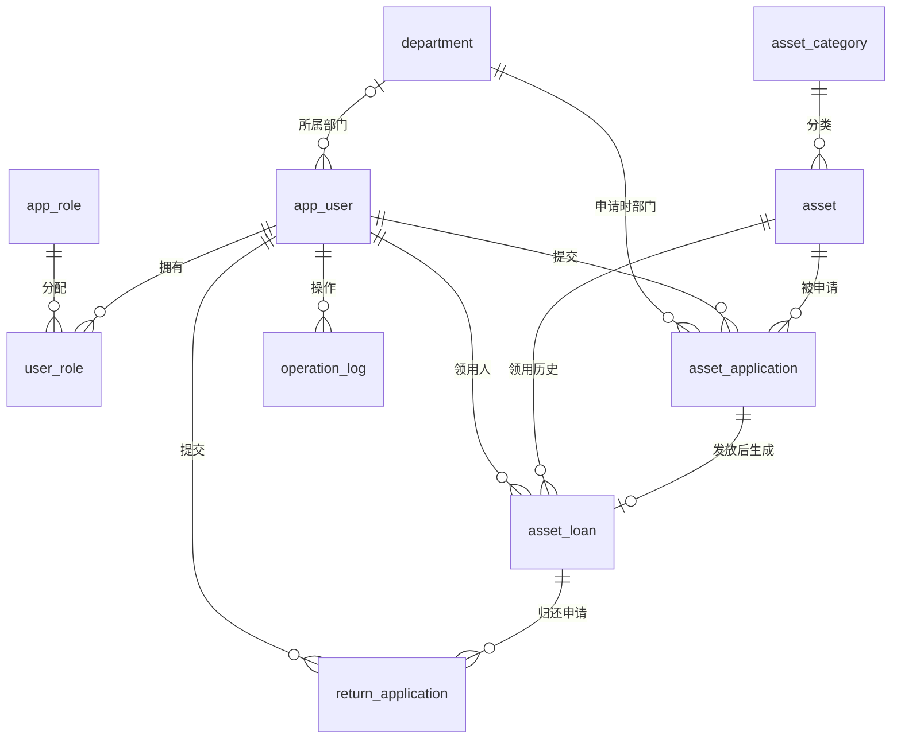

# 数据库设计

版本：v0.1
关联工作项：[2.3]
状态：数据库初版设计与初始化完成，业务实现待验证

## 一、表结构概览

| 表名 | 用途 |
|---|---|
| department | 部门 |
| app_user | 用户及账号状态 |
| app_role | 固定角色 |
| user_role | 用户与角色关联 |
| asset_category | 资产类别 |
| asset | 资产档案 |
| asset_application | 领用申请及审批信息 |
| asset_loan | 实际领用与归还记录 |
| return_application | 归还申请 |
| operation_log | 业务及管理审计日志 |

## 二、主要关系

图中省略审批人、发放人及接收人等辅助关联，
完整字段和外键以SQL脚本为准。

## 三、关键约束

- 资产编号、用户名、角色编码、部门名称及类别名称唯一。
- 同一员工对同一资产最多有一条待审批或待发放申请。
- 一条领用申请最多生成一条领用记录。
- 一件资产最多有一条未结束的领用记录。
- 一条领用记录最多有一条待确认的归还申请。
- 历史业务数据保留，外键不设置级联删除。
- version用于后续并发修改校验，单独存在该字段不代表已实现并发控制。

## 四、服务端负责的规则

- 角色权限、部门范围及本人记录归属校验。
- 合法状态转换和账号停用、角色变更生效。
- 领用记录中的资产及领用人与原申请保持一致。
- 归还申请人必须是关联记录的当前领用人。
- 发放、接收及相应日志在同一事务内提交或回滚。
- 最后一个启用的系统管理员不可被停用或降权。

## 五、初始化顺序

在已创建的空数据库asset_management中依次执行：

1. schema.sql：用户与基础数据表。
2. 02_asset_and_application.sql：资产及领用申请表。
3. 03_loan_return_log.sql：领用、归还及日志表。
4. 04_seed_basic.sql：角色、部门、类别及演示资产。
5. 05_seed_users.sql：演示用户及角色关联。
   执行前在同一MySQL连接中设置@demo_password_hash；
   执行后核对账号与角色，无错误再手动COMMIT。
   密码哈希使用PasswordHashTool生成，明文密码不写入脚本。

脚本位于src/main/resources/db。
当前脚本用于首次初始化，不支持在已有结构和数据上重复执行。
已初始化5个演示用户，密码以BCrypt哈希保存。
当前仅完成账号数据准备，网页登录功能尚未实现。

## 六、已执行的约束验证

| 验证项 | 实际结果 | 结论 |
|---|---|---|
| 同一员工重复提交同一资产的待审批申请 | 第二次插入报ERROR 1062，命中uk_application_active | 通过 |
| 测试数据回滚 | ROLLBACK后测试账号数量为0 | 通过 |
| 取消后重新申请 | 原申请为CANCELLED、标记为NULL；新申请为PENDING、标记为1 | 通过 |
| 同一资产重复建立有效领用记录 | 第二次插入报ERROR 1062，命中uk_loan_active_asset | 通过 |
| 同一领用记录重复提交待确认归还申请 | 第二次插入报ERROR 1062，命中uk_return_pending | 通过 |
| 领用及归还测试数据回滚 | ROLLBACK后两个测试账号数量均为0 | 通过 |

本次验证为单连接数据库约束测试，
不代表接口权限、事务流程或多连接并发测试已经通过。