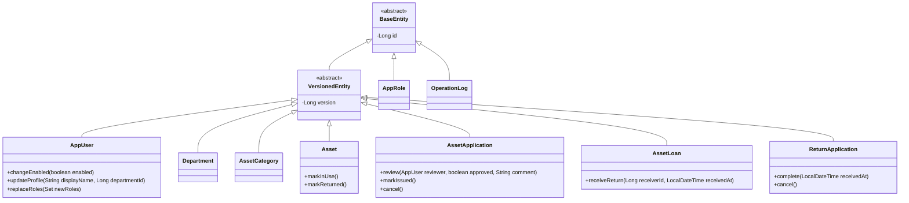
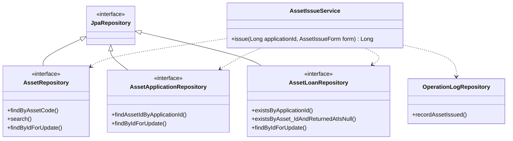

# 核心类与业务接口设计

关联工作项：[2.5]

本文根据当前实现整理。类图省略部分字段、访问器及辅助方法。

## 1. 实体继承结构

### 抽象类职责

- BaseEntity：集中声明主键 id，使用 JPA 的主键生成策略。
- VersionedEntity：继承主键，增加 @Version 版本字段。
- 两个抽象类均使用 @MappedSuperclass，共享映射而不单独建立实体表。
- 可修改业务实体继承 VersionedEntity，用于检测并发修改。
- AppRole 和 OperationLog 直接继承 BaseEntity。

实体方法维护自身状态规则；跨实体权限、加锁和事务协调由 Service 完成。

## 2. 持久化接口与服务依赖

Repository 接口由 Spring Data JPA 提供实现。
Service 通过依赖注入使用接口，不自行创建持久化实现对象。

OperationLogRepository 虽以 Repository 命名，
实际是执行日志写入的具体类，不是 Java interface。
上图展示发放服务的部分主要依赖，并非完整依赖清单。

## 3. 主要业务方法

以下为 Service 业务方法概览，不是 HTTP 路由清单。

| 服务 | 方法 | 主要职责 |
|---|---|---|
| AssetService | create、update | 资产建档、修改及日志记录 |
| AssetApplicationService | submit | 校验领用资格并创建申请 |
| ApplicationApprovalService | review | 部门审批、禁止本人审批及状态检查 |
| ApplicationCancelService | cancel | 申请人取消符合条件的领用申请 |
| AssetIssueService | issue | 原子完成资产发放 |
| ReturnApplicationService | submit | 领用人提交归还申请 |
| ReturnReceiveService | receive | 管理员接收归还并恢复资产闲置状态 |
| ReturnCancelService | cancel | 申请人取消尚未完成的归还申请 |
| UserAdminService | create、updateProfile、changeEnabled、updateRoles | 用户与角色管理、最后管理员保护 |
| DepartmentAdminService | create、update | 部门维护 |
| AssetCategoryAdminService | create、update | 类别维护 |
| OperationLogService | search | 按权限查询业务日志 |
| AdminOperationLogService | search | 按权限查询管理日志 |

## 4. 事务与并发约束

- 写入业务由 Service 的事务方法组织。
- 发放操作按资产、领用申请顺序加锁。
- 归还接收与取消按资产、领用记录、归还申请顺序加锁。
- 表单携带版本号，服务端核对当前版本。
- 数据库唯一约束防止重复有效领用等非法数据。
- 用户启停与角色修改共用 SYSTEM_ADMIN 角色行锁。
- 成功审计日志与对应业务变更处于同一事务。
- 日志方法异常时，业务变更必须整体回滚。

## 5. 实现验证

已通过以下自动化测试：

1. 同一资产竞争发放，恰好一次成功。
2. 归还接收与取消竞争，最终状态一致。
3. 并发停用管理员时保留最后一个可用管理员。
4. 日志方法异常时，发放事务完整回滚。

详细结果见《业务与权限测试记录.md》。