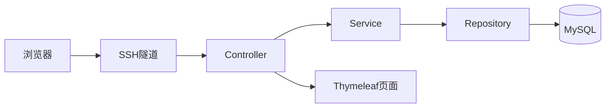

# 系统架构与并发方案

版本：v0.1
关联工作项：[2.4]
状态：已结合当前实现与验证结果更新

## 一、技术与部署

采用Java 21、Spring Boot、Spring MVC、Thymeleaf、
Spring Data JPA和MySQL，具体依赖版本以pom.xml为准。
登录与权限控制使用Spring Security

采用分层单体应用，便于单人开发和课程演示。

本地完成开发测试；
云端采用Docker Compose部署应用与MySQL。
应用端口仅绑定服务器127.0.0.1:8080，演示时通过SSH隧道访问。
数据库不向公网发布端口。
当前未配置公网HTTPS入口。

## 二、代码分层

根包：com.veici.asset。

| 包 | 职责 |
|---|---|
| controller | 接收请求、校验输入格式、返回页面或结果 |
| service | 权限与业务规则校验、状态转换、事务编排 |
| repository | 数据查询、持久化及加锁查询 |
| entity | 数据表映射及版本字段 |
| dto | 表单、请求和展示数据，避免直接绑定实体 |
| security | 登录、角色检查及账号权限生效 |
| exception | 业务异常与统一错误处理 |
| config | 应用配置 |

核心写入、权限规则及事务编排集中在Service。
当前部分只读查询由Controller直接调用Repository。
页面不直接展示用户实体，避免泄露密码哈希等字段。

## 三、事务边界

事务放在Service的公开业务方法上，
由Controller通过Spring管理的Service调用。

发放事务包含：
申请校验、资产状态更新、领用记录创建、
申请状态更新和成功审计日志。

归还接收事务包含：
申请及领用记录校验、结束领用、
资产恢复闲置、申请完成和成功审计日志。

审批、取消、档案修改及管理操作，
其数据更新与成功审计日志同事务提交。

失败时整体回滚。
业务异常使用运行时异常，或显式配置回滚规则；
不得吞掉异常后提交部分修改。
事务内不执行耗时网络调用。

## 四、并发控制

### 4.1 档案与申请修改

实体的version字段使用JPA的@Version管理。
编辑请求携带读取时的版本，并在服务端核对。

审批与取消须校验版本和当前状态。
旧请求不得覆盖已生效的更新；
冲突时提示刷新，不自动重放用户决策。

### 4.2 发放与归还接收

使用事务内的数据库行锁保护同一资产的发放和接收。

需要锁定多个记录时，统一按以下顺序获取：
资产 → 领用申请 → 领用记录 → 归还申请。
不涉及的记录跳过。

加锁后重新检查状态、关联关系及权限。
唯一约束作为防止重复有效领用的最后一道保护。

锁等待超时或死锁时回滚事务，
提示稍后重试，不返回成功结果。

### 4.3 重复申请

数据库唯一约束保证：

- 同一员工对同一资产最多一条未结束的领用申请；
- 同一资产最多一条有效领用记录；
- 同一领用记录最多一条待确认归还申请。

约束异常在事务回滚后转换为明确的业务提示。

### 4.4 系统管理员保护

停用或移除系统管理员角色时，
先锁定SYSTEM_ADMIN角色行，再检查启用管理员数量。
所有相关管理操作采用同一规则，
防止两个请求同时移除最后的管理员。

## 五、登录与权限

- 使用会话认证，密码通过BCrypt校验。
- 未登录、角色不符和数据范围越权均在服务端拒绝。
- 每个受保护请求检查账号是否启用，并取得当前角色及部门；
  不仅依赖登录时缓存的权限。
- 停用和角色变更对提交完成后的后续请求生效。
- 数据修改请求进行CSRF校验。
- 业务日志与管理日志分别按角色授权查询。

## 六、一万用户场景分析

课程的一万用户目标属于设计场景，
当前服务器尚未通过该规模验证。

示例负载假设：
一万在线用户平均每10秒发送一次动态请求，
约为1000请求/秒；
假设查询占90%、写入占10%。
该数值仅用于设计分析，不是实测吞吐量。

当前已采用分页查询、事务边界和关键记录加锁等措施。

面向一万用户场景，后续需验证和完善：
- 查询上限、索引及执行计划；
- 数据库连接池容量与请求并发控制；
- 响应时间、错误率、CPU、内存及锁等待监测；
- 高负载下的限流、容量规划与扩展方案。

以上待验证措施不视为已完成的容量保障。

若实测不足，评估应用与数据库分离、查询优化、
只读数据缓存及多实例部署。
多实例部署需同时解决共享会话和权限更新一致性。
这些扩展暂不计为已实现功能。

## 七、验证计划

1. 测试未登录、跨角色及跨部门访问。
2. 使用独立连接并发发放同一资产，确认最多一次成功。
3. 测试审批与取消、接收与取消的竞争操作。
4. 模拟事务中途失败，确认无部分更新。
5. 验证停用账号、角色变更及最后管理员保护。
6. 从小负载逐步增加，记录数据量、请求比例、
   吞吐量、P95响应时间及错误率。

当前已完成业务权限验证，以及并发发放、归还接收与取消竞争、
最后管理员保护和日志异常回滚自动化测试。

已完成本地单线程Repository分页查询性能采样。
尚未完成一万用户并发或HTTP接口容量测试。
具体结果及验证边界见《业务与权限测试记录》。