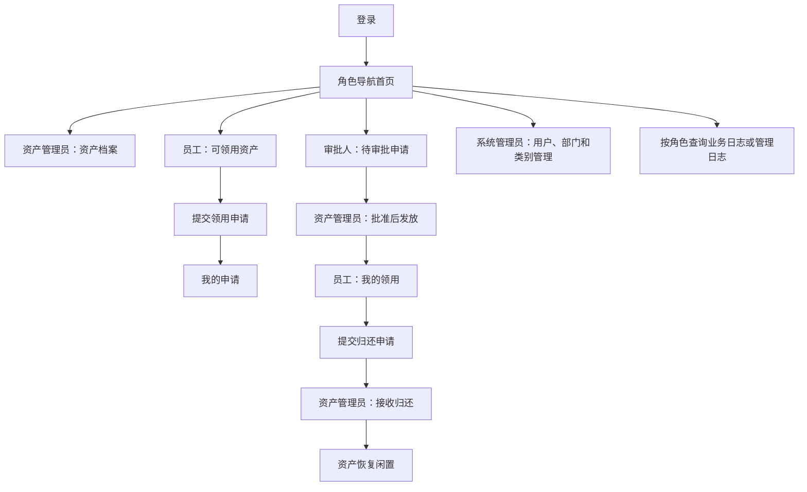

# 页面与请求接口说明

关联工作项：[2.6]

系统采用 Spring MVC、Thymeleaf 和会话认证。
页面请求返回 HTML，写入操作通过表单 POST 提交，不是 JSON REST API。

## 1. 页面流程

图中跨角色步骤由对应账号分别完成，不表示同一账号拥有全部权限。

## 2. 登录与首页

| 方法 | 路径 | 用途 |
|---|---|---|
| GET | /login | 登录页面 |
| POST | /login | 提交 username、password 和 CSRF token |
| GET | / | 登录后的角色导航首页 |
| POST | /logout | 退出登录，携带 CSRF token |

登录由 Spring Security 处理。
登录失败返回登录错误提示，成功后进入首页。

## 3. 资产档案与领用

| 方法 | 路径 | 权限 | 主要参数或用途 |
|---|---|---|---|
| GET | /assets | ASSET_ADMIN | page、assetCode、name、categoryId、status |
| GET | /assets/new | ASSET_ADMIN | 新建资产表单 |
| POST | /assets | ASSET_ADMIN | assetCode、name、categoryId、purchaseDate、originalValue、location |
| GET | /assets/{id}/edit | ASSET_ADMIN | 编辑资产表单 |
| POST | /assets/{id}/edit | ASSET_ADMIN | version、name、categoryId、purchaseDate、originalValue、location |
| GET | /employee/assets | EMPLOYEE | page、assetCode、name、categoryId；仅展示可领用资产 |
| GET | /employee/assets/{id}/apply | EMPLOYEE | 领用申请表单 |
| POST | /employee/assets/{id}/apply | EMPLOYEE | purpose |
| GET | /employee/applications | EMPLOYEE | page；查询本人申请 |
| POST | /employee/applications/{id}/cancel | EMPLOYEE | version；取消本人符合条件的申请 |

资产路径中的 id 表示资产 ID；
/employee/applications/{id}/cancel 中的 id 表示领用申请 ID。

资产编辑不能通过表单任意修改资产状态。
申请人身份由服务端登录信息确定，不接受客户端指定其他申请人。

## 4. 审批与发放

| 方法 | 路径 | 权限 | 主要参数或用途 |
|---|---|---|---|
| GET | /approver/applications | DEPT_APPROVER | page；本部门可审批申请 |
| GET | /approver/applications/{id} | DEPT_APPROVER | 审批详情 |
| POST | /approver/applications/{id} | DEPT_APPROVER | version、decision、comment |
| GET | /admin/issues | ASSET_ADMIN | page；已批准待发放申请 |
| GET | /admin/issues/{id} | ASSET_ADMIN | 发放确认页面 |
| POST | /admin/issues/{id} | ASSET_ADMIN | applicationVersion、assetVersion |

上述路径的 id 均表示领用申请 ID。

decision 取 APPROVE 或 REJECT。
禁止本人审批及跨部门审批，驳回时必须填写理由。
发放同时校验申请版本、资产版本及当前业务状态。

## 5. 归还

| 方法 | 路径 | 权限 | 主要参数或用途 |
|---|---|---|---|
| GET | /employee/loans | EMPLOYEE | page；本人领用记录 |
| POST | /employee/loans/{id}/return | EMPLOYEE | id 为领用记录 ID，提交归还 |
| POST | /employee/loans/returns/{id}/cancel | EMPLOYEE | id 为归还申请 ID，携带 version |
| GET | /admin/returns | ASSET_ADMIN | page；待接收归还申请 |
| POST | /admin/returns/{id}/receive | ASSET_ADMIN | id 为归还申请 ID，携带 version |

仅领用人可申请归还或取消本人的待处理归还申请。
接收归还后，资产恢复闲置，领用记录写入归还时间及接收人。

## 6. 用户与基础数据管理

以下接口均要求 SYSTEM_ADMIN。

| 方法 | 路径 | 参数或用途 |
|---|---|---|
| GET | /system/users | page；用户列表 |
| GET | /system/users/new | 新建用户表单 |
| POST | /system/users | username、displayName、departmentId、password、confirmPassword |
| GET | /system/users/{id}/edit | 编辑用户表单 |
| POST | /system/users/{id}/edit | version、displayName、departmentId |
| POST | /system/users/{id}/enabled | version、enabled |
| GET | /system/users/{id}/roles | 角色分配页面 |
| POST | /system/users/{id}/roles | version、roleIds |
| GET | /system/departments | page；部门列表 |
| GET | /system/departments/new | 新建部门表单 |
| POST | /system/departments | name |
| GET | /system/departments/{id}/edit | 部门编辑表单 |
| POST | /system/departments/{id}/edit | name、version |
| GET | /system/categories | page；类别列表 |
| GET | /system/categories/new | 新建类别表单 |
| POST | /system/categories | name |
| GET | /system/categories/{id}/edit | 类别编辑表单 |
| POST | /system/categories/{id}/edit | name、version |

用户创建与角色分配是不同操作。
禁止停用最后一个启用的系统管理员，
也禁止移除其系统管理员角色。

## 7. 日志查询

| 方法 | 路径 | 权限 | 日志范围 |
|---|---|---|---|
| GET | /admin/logs | ASSET_ADMIN | BUSINESS |
| GET | /system/logs | SYSTEM_ADMIN | ADMIN |

查询参数：
startDate、endDate、action、targetType、targetId、page。

日期格式为 yyyy-MM-dd，page 从 0 开始。
分页链接保留筛选条件。
日志页面仅提供查询，不提供修改或删除接口。

## 8. 返回与错误处理

- 正常 GET 返回对应的 HTML 页面。
- 写入成功通常重定向到列表，并显示成功提示。
- 表单校验失败时显示字段错误，或返回相应错误提示。
- 状态冲突和版本变化通过页面提示或重定向后的提示反馈。
- 未登录访问受保护页面时引导登录。
- 角色或数据范围越权返回拒绝访问；CSRF 校验失败返回 403。
- 对不存在或状态不允许的对象，部分接口使用 404 或 409。
- 未预期的服务端异常可能返回 500，需结合服务器日志排查。

业务操作失败并不一定表现为 HTTP 4xx：
错误提示页面在重定向后可能返回 HTTP 200。
测试应同时检查页面提示、数据库状态与审计日志。

## 9. 请求安全约束

- 写入请求使用 POST 并携带有效 CSRF token。
- 页面按钮可见性不能替代服务端权限校验。
- 对象 ID、用户角色、所属部门及记录归属均由服务端校验。
- 修改操作使用版本字段拦截旧页面提交。
- 普通员工查询范围由当前登录账号确定。
- 页面使用转义输出展示用户输入和日志内容。

## 10. 验证依据

业务与权限测试、并发事务测试及云端核心流程验证结果，
分别见《业务与权限测试记录.md》和《云端部署验证记录.md》。